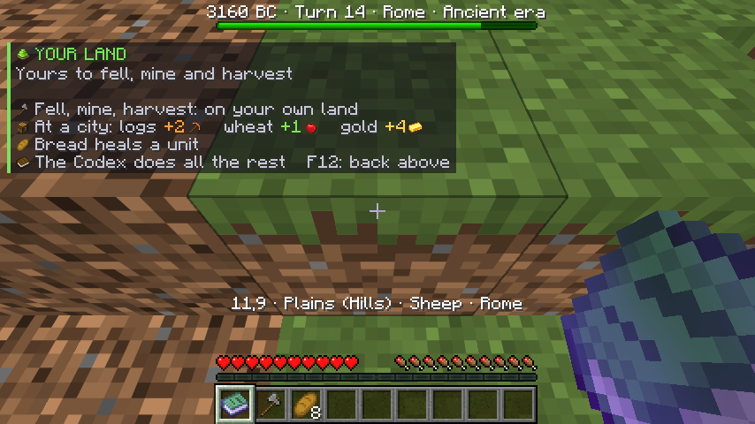

# Civ V Living World

Civilization, played inside Minecraft. One game, one window, alone or with friends.

The map is the Minecraft world, laid out in hexes of real terrain. Your units and cities stand
in it. You rule from above the land as in a strategy game, or walk into your own capital and
ring the bell in its hall to end the turn. The rules, the technology tree, the other
civilizations and how they think are those of Civilization V, as rebuilt by the open-source
game [Unciv](https://github.com/yairm210/Unciv), which runs inside the mod. Civilization V
itself is not needed.

| Wonders around the capital | The social policies, as trees |
|---|---|
|  |  |

| What a city can build | On foot, on your own land |
|---|---|
|  |  |

All pictures are the real Minecraft client running this mod.

## Play it

You need **Minecraft: Java Edition** (your own account) and the free
[Prism Launcher](https://prismlauncher.org).

1. Download **`CivLivingWorld-<version>-prism.zip`** from the
   [latest release](../../releases/latest).
2. In Prism Launcher: **Add Instance > Import**, choose the zip, OK. It holds Minecraft 26.3
   with Fabric, Fabric API and the mod; Prism fetches the game itself.
3. Start the instance. The world opens by itself and you sit down at the table where a game
   is set up: choose a civilization, a map, and begin.

To play with friends, one of you runs the server (or opens a game to LAN), everybody imports
the same zip, and the others join the host's address. [docs/INSTALL.md](docs/INSTALL.md) has
every step, also for a server and for installing by hand.
Nederlands: [docs/MEESPELEN.md](docs/MEESPELEN.md).

[docs/GAMEPLAY.md](docs/GAMEPLAY.md) is the player's guide; F1 in the game shows the mouse
and the keys.

## What it is

- **A whole game of Civilization**: found cities, research, build, grow, explore, fight, make
  deals, friends and enemies, choose your gods, send spies, win or fall. Up to seven other
  civilizations and twelve city-states, eight difficulty levels, four game lengths, ten kinds
  of map. Unciv's civilizations, and the Shoshone besides.
- **Seen from above, as a strategy game**: the Minecraft world at an angle from above with the
  mouse as a pointer, and around it what Civilization V has around its map: the realm's
  numbers along the top, research top left, the selected unit and its orders bottom left, the
  turn button over a small map bottom right, a banner over every city. Left click selects,
  right click sends.
- **Numbers and pictures, not walls of text**: every measure has one small picture, the same
  everywhere; a list says in brief what each choice gives; the technologies and the social
  policies are trees in which you see what leads to what; a city in detail is a sheet of bars
  and numbers; an attack is foretold before it is made. News is a column of small pictures:
  a click goes to where it happened.
- **With others, each their own civilization**: everybody moves at once; two players at war
  move one after the other; the computer plays for whoever is away; a newcomer takes over a
  civilization or looks on ([docs/MULTIPLAYER.md](docs/MULTIPLAYER.md)).
- **A Minecraft cast**: units are zombies, skeletons, piglins, creepers, ghasts, ravagers and
  golems by kind and strength; every city has its wall and towers in its owner's colour, and
  is a town of blocks that changes with the ages, from thatched huts to glass towers.
- **Wonders you can see**: every wonder of the world stands on a hex of its own beside its
  city, many times the size of a house: the Pyramids, Stonehenge, a colossus of copper.
- **And on foot when you like**: F12 sets you down where you point, on your own land. Your
  hands work your own land only: fell its trees, reap its fields, mine its hills, and carry
  what you gather to a city, where it becomes production, food or gold (never more in a turn
  than the city makes itself). Bread heals your soldiers, and the bell in the hall ends the
  turn.
- **A ruler in person**: an enemy unit you come near sends its soldiers at you, one after the
  other; each one you beat costs that unit health in the game. Fall, and your people carry you
  home for a tenth of the treasury. Governors sell arms your people know how to make.
- **A lobby**: first the game (the land with a sketch of its shape, the rules), then who
  plays: everybody picks a civilization, says ready, and the keeper begins.
- **Nothing to type**: everything is a button, a list or a place on the map.

## How far it has been tried

Plainly, because "the tests pass" is not "it works". [docs/TESTING.md](docs/TESTING.md) has
the detail, [docs/KNOWN_LIMITATIONS.md](docs/KNOWN_LIMITATIONS.md) what is missing.

| Level | What ran |
|---|---|
| Tests | 123: the engine plays real games through the same interface the mod uses (a 150-turn game, a war and a peace, deals the AI accepts and refuses, a religion founded, a city taken by assault, an air strike, a nuclear strike, a game won, a game lost, a save and reload, a game for several people, the Shoshone, a ruler's own fights and their limits) |
| A Minecraft server, no screen | 63 checks: a game is started, drawn, and played through the code a player's clicks reach; soldiers step out to meet a ruler on foot and one beaten costs their unit health; a second game in the same world; a game for two. On Linux and on Windows 11 |
| The real Minecraft client | Every screen clicked through with real mouse and keyboard events, alone and with two clients on one server, on Linux and on Windows |
| People | One player, a few sessions on a real graphics card. **A whole evening with several people has not happened yet**: expect rough edges and tell us |

## Build from source

Needs JDK 25 and a few GB of memory for the first build (it downloads Minecraft and Fabric).

```bash
scripts/dev/fetch-unciv.sh                   # once: the engine, into libs/ (not in git; checksum checked)
./gradlew :bridge:test :engine:test          # 123 tests, no Minecraft needed
./gradlew :fabric:build                      # the mod jar in fabric/build/libs
./gradlew :fabric:runServer -Dlivingworld.selftest=true --args=nogui   # 63 checks on a real server
scripts/dev/prod-client.sh start             # Linux: the real client on a virtual screen (see the script)
```

`bridge/build/preview/*.png` (written by the tests) shows every era's city and every wonder
without starting Minecraft.

```
bridge/    The core, plain Java, no Minecraft classes: coordinates, the picture of a game
           (state), commands, the board model that turns a game into blocks, the buildings.
engine/    The game itself: Unciv's rules and AI, run without its window.
fabric/    The Minecraft mod (Fabric, Minecraft 26.3). Compiles bridge and engine into its own
           jar and carries the engine with it: one file to install.
scripts/   server/ is the server pack; share/ the Prism instance; dev/ the tools to fetch the
           engine and to run the real client without a screen.
docs/      Gameplay, multiplayer, install, architecture, limits, licences.
```

## The older way

This project began as a bridge: Minecraft showing a running Civilization V and steering it
through Civ's debug socket. It worked, and it is still in the mod, but two games side by side
never felt like one. [docs/CIV5_BRIDGE.md](docs/CIV5_BRIDGE.md) describes it.

## Licences and names

This project is MIT ([LICENSE](LICENSE)). The engine it carries, Unciv, is MPL-2.0 and is
used unmodified; [NOTICE.md](NOTICE.md) and [docs/DEPENDENCIES.md](docs/DEPENDENCIES.md) say
what else is in the box.

This is a fan project. It is not affiliated with or endorsed by Mojang or Microsoft
(Minecraft), by Firaxis Games or 2K (Sid Meier's Civilization), or by the Unciv project. It
contains no code or art from Civilization V. You need your own copy of Minecraft: Java Edition.
