# Gameplay

Civilization, played inside Minecraft. One game, one window: the map is the Minecraft world,
seen from above as in a strategy game, with your units and cities standing in it. The rules and
the other civilizations are those of Civilization V, as rebuilt by the open-source game
[Unciv](https://github.com/yairm210/Unciv), which runs inside the mod.

What has been tried, and how, is in [TESTING.md](TESTING.md). New to it? [FIRST_GAME.md](FIRST_GAME.md)
walks through a first evening. Every civilization is in [CIVILIZATIONS.md](CIVILIZATIONS.md),
every unit and the creature it is in [UNITS.md](UNITS.md).

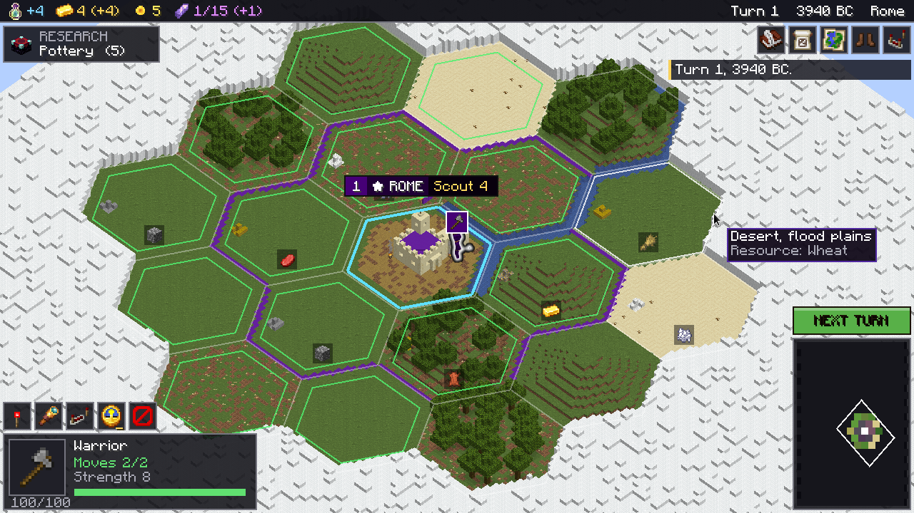

## Starting

Start the instance (Start menu or desktop, *Civ V Living World*). The world opens by itself.

**The first time, a table to set the game up at**, in two steps shown along the top.

1. **The game.** On the left the world: a sketch of what each kind of land looks like (one
   continent, islands, a sea in the middle), its name between two arrows, a line on what it
   means for a game, and the size. On the right the rules: the length, the difficulty, how many
   civilizations the computer plays, city-states, barbarians, ancient ruins, spies, nuclear
   weapons, one city each, and which ways of winning count. *Next: who plays* goes on.
2. **Who plays.** On the left every civilization: point at one to see who leads it, its gift
   as a few points, and what only its people build or train, each with its numbers; click to
   lead it (or leave it at *Any*). On the right the game in short and who is at the table.
   *Begin the game* makes the world; you then look down at your Settler and your Warrior.
   *Change the game* goes back a step.

| The game | Who plays |
|---|---|
| 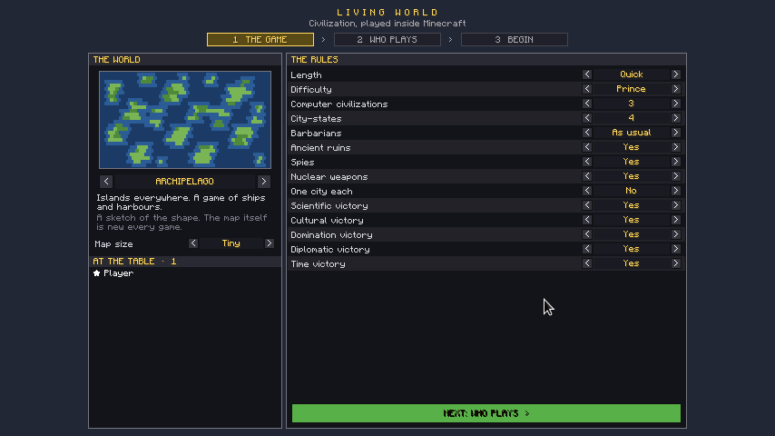 | 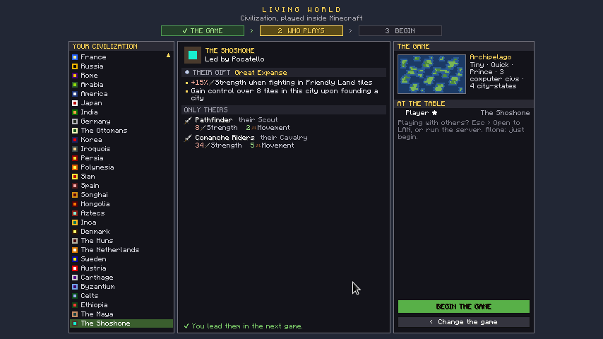 |

With others at the table everybody says *I am ready* in the second step, and the game begins
on a count of three (see [MULTIPLAYER.md](MULTIPLAYER.md)).

Besides Unciv's own civilizations there is one this mod adds: **the Shoshone** under
Pocatello. Their cities begin with eight hexes more than anybody's, their soldiers fight 15%
stronger on their own land, the Pathfinder is their Scout and the Comanche Riders their
Cavalry.

**After that**, the game you were playing is there again (it is saved after every turn), behind
a page with *Continue*, *A new game...* and who plays. Enter continues. The same page is
behind the head at the top right, or **L**, at any time.

Nothing has to be typed, ever.

## Playing with others

Several people can play one game, each with a civilization of their own; see
[MULTIPLAYER.md](MULTIPLAYER.md) for how to host one. In short: everybody at the table when
the game begins gets their own civilization; whoever comes later takes one over from the
computer, rules along with somebody, or looks on. **Everybody moves at the same time**, and
the turn passes when everybody has ended theirs. **Two people at war with each other move one
after the other** instead, the one that comes first in the game's list first; everybody else
goes on moving at once. Somebody who is away has their turns played by the computer, so nobody
waits for them. Each sees only what their own people have seen.

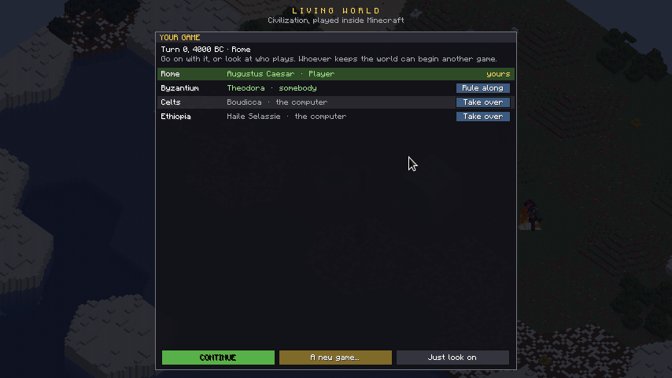

## Ruling from above

The view is the one of a strategy game: the land at an angle from above, the mouse a pointer.
Around it, where Civilization V has them:

| Where | What |
|---|---|
| Along the top | Science a turn, gold (and what a turn brings), happiness, the golden age your spare happiness saves up for, culture towards the next policy, faith (and what the next pantheon or prophet takes), the strategic resources you have to spare and how many kinds of luxury; the turn and the year. Point at any of them to read what it is; click for the page behind it |
| Top left | What your scholars research and how long it takes. Click to choose |
| Top right | What each hex yields, the known world on one map, the tree of technologies, policies, faith and religion, the ways to win, who plays, the other civilizations, your cities and units, settings, walking (see below); proposals when somebody has put something to you, and a golden apple when a Great Person is yours for the choosing |
| Right | News as small pictures: click one to go there, right-click to put it away |
| Bottom left | The unit you selected: what it is, its moves, strength and health, and a button for everything it can do right here |
| Bottom right | The small map (click it to go there) and, above it, the **turn button** |
| On the land | Whose land is whose: a wash of the owner's colour with a broad band of it along the border, and land you have seen but do not see now a shade darker. A banner over every city (size, name, what it builds and in how many turns), a flag over every unit with a gold pip for each promotion, a picture on every resource, the hex grid |

The first time, a page says how it is worked; **F1** (or the book at the top right) brings
it back whenever you want it.

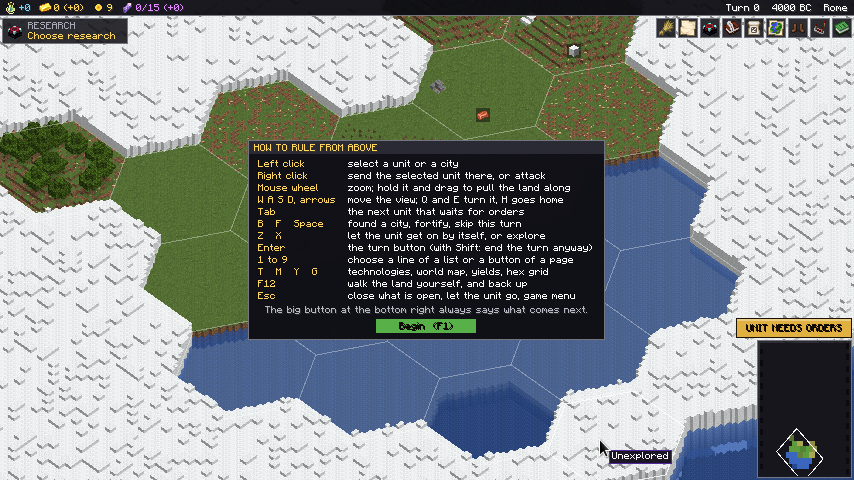

**The mouse**

- **Left click** a unit of yours (or its flag) to select it. The hexes it can reach this turn
  get a green outline, enemies it can attack a red one. Several units on one hex: click again
  for the next.
- **Right click** the land to send the selected unit there, however far; on an enemy it
  attacks. A destination further than one turn is walked over the coming turns.
- **Left click** one of your cities, or its banner, for what it builds; anybody else's city
  or unit to deal with its owner.
- Rest the pointer on a hex to read what it is and who stands there.

**The view**

| | |
|---|---|
| W A S D, arrow keys, or the pointer against the edge of the screen (full screen only) | Move over the land |
| Mouse wheel | Zoom |
| Hold the wheel and drag | Pull the land along |
| Q, E | Turn the view an eighth |
| H | Home: your capital |
| G | Hex grid on or off |
| Y | What each hex yields: food, production, gold and the rest, on or off |
| T | The tree of technologies |
| P | The social policies, as a tree |
| V | The ways to win: how far you and the others are, the score, how you compare |
| R | Faith and religion |
| L | Who plays: continue, take a civilization, look on, a new game |
| N | The news so far: everything the game has told you, the newest first, each with its turn |
| O | The colours of the borders on or off |
| M | The known world on one flat map; click it to go there |
| Tab | The next unit that waits for orders |
| B, F, Space | Found a city, fortify (or sleep), skip this turn: for the selected unit |
| Z, X | Let the selected unit get on with it by itself (a Worker works, a soldier acts), or explore by itself |
| Enter | The turn button |
| F1 | The page of mouse and keys |
| Esc | Close the list, let the unit go, then the game menu |

**The turn button** always says what the game needs next, as in Civilization: *Choose
research*, *Choose production*, *Adopt a policy*, *Choose a belief*, *Cast your vote*; then
*Unit needs orders* for as long as a unit has nothing to do (click to go to it; with Shift the
turn ends anyway); and when nothing is left, *Next turn*.

**Lists.** Research and what a city builds come as a list down the left side: one click on a
line chooses it, and so does its number (1 to 9). **Every line says what it is and does**: the
first of it under its name, all of it on a card when you point at the line (what a building
gives and costs to keep, how strong a unit is and what it can do, what a technology makes
possible). Under a city's list: *Details* (the city as a sheet: what it makes a turn as six
numbers, three bars with the turns left until it grows, finishes what it builds and widens its
border, its walls, and every building with its picture, what it gives and what it costs to
keep; from there a building can be sold), *Faith* (what faith buys
there), *Line up* (what you choose next is built after what the city builds now, one after the
other; the top of the list says what is lined up), *Buy with gold* and *City affairs* for
everything else.

| What Rome can build | Rome in detail |
|---|---|
| 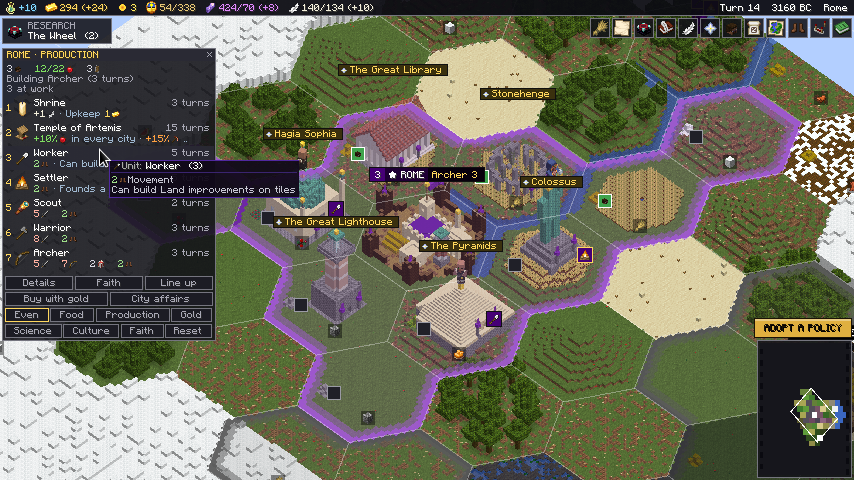 | 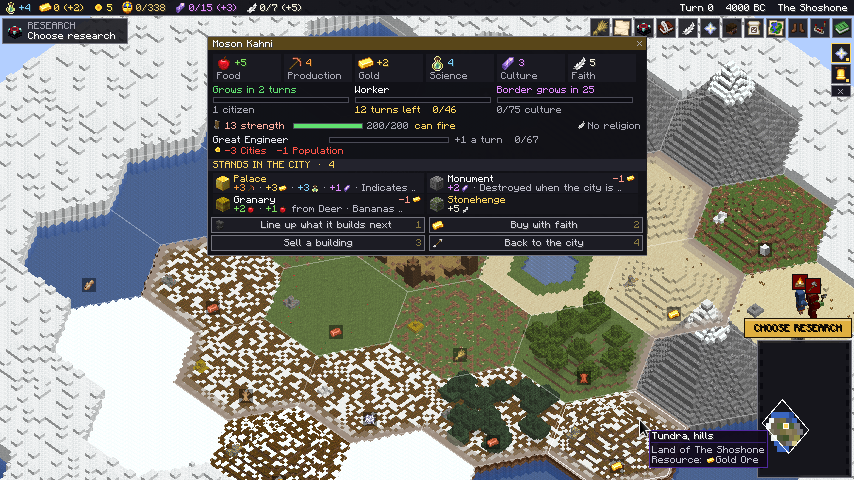 |

The banner over a city says what it builds and **how many turns are left**, one less every
turn.

**Who works where.** While a city's list is up, every hex its citizens can work carries a
small mark: green with a head is worked, dark is free. Click a free one and a citizen works
there from now on (gold edge), whatever the city would choose itself; click it again to leave
the place to the city. Under the list: what the citizens look to when they choose for
themselves (*Even*, *Food*, *Prod*, *Gold*, *Sci*, *Cult*, *Faith*) and *Reset*. The lines
above the list say how many work, how many are idle, and whether roads or harbours join the
city to your capital (that is the trade route of these rules: it pays gold every turn).

A city with a Market, a Workshop, a University or the like has places in those buildings too:
under the list a line for each kind (*Merchant 0/1*) with **-** and **+**. A citizen you put
there stays there, and the city leaves its specialists alone from then on, until *Reset*.

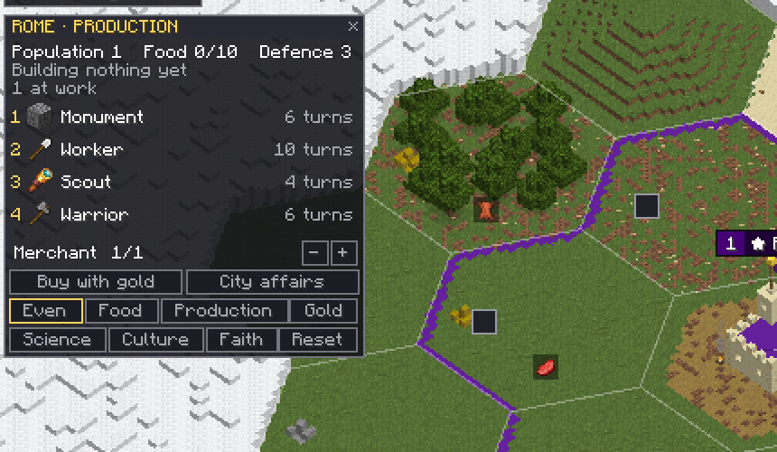

**Numbers and pictures, not sentences.** Every measure of the game has one small picture, the
same everywhere on the screen, with its number before it in the measure's own colour:

| Picture | Measure | | Picture | Measure |
|---|---|---|---|---|
| Apple | Food | | Feather | Faith |
| Copper pickaxe | Production | | Sunflower | Happiness |
| Gold ingot | Gold | | Sword | Strength |
| Bottle of experience | Science | | Bow | Ranged strength |
| Amethyst shard | Culture | | Boots | Movement |

A line in a list says what the thing gives in brief, what carries a number first (*+2* and the
shard for a Monument); a technology shows what it opens, each with its own picture. The card
by the pointer has all of it, a thing a line, with the words written out beside the pictures.

**The tree of technologies** (T, or the button under the research list) shows every
technology from the oldest to the newest with a line to what it builds on: green is known,
blue is being researched, a white edge can be started now. In every box, under the name, small
pictures of what the technology opens: units, buildings, wonders, work on the land. Click any
of them and your scholars work towards it by way of everything it needs first. Point at one to
read what it brings. The wheel moves along the ages, whose names stand over the columns.

**The social policies** (P, the culture at the top, or the turn button when one is due) are
trees: every branch a card, and in it each policy under the one it builds on, a step in, with
a line from the one to the other, so what leads to what is seen at a glance. A square before
each name says how near it is: green is adopted, full gold can be chosen now (one click),
a gold outline is next in reach, grey is not yet. The line to a policy turns green when the
one before it is adopted. Under each name one short line of what it gives, in the branches
of your own age; later branches show names only, and the card by the pointer always has the
rest. The top of each card says what opening the branch gives and how much of it you have
(*2/5*); the bar at the top right is your culture towards the next policy, with the turns it
still takes.

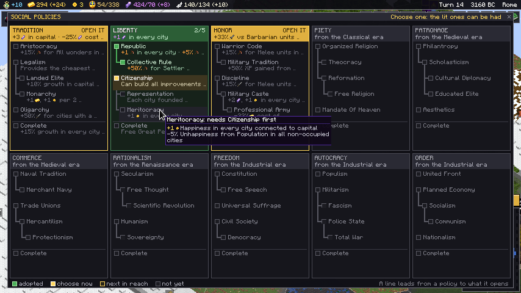

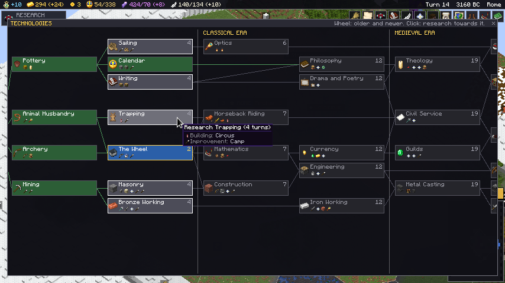

**What the land yields** (Y) puts on every hex you have seen what it gives a city that works
it, by the game's own count.

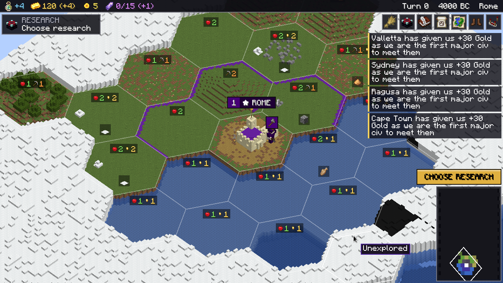

**Everything else** (the other civilizations and what you can do with each, deals, proposals,
beliefs, the vote for a world leader, the overview of your cities and units, the settings, a
new game) opens as a panel over the middle of the map, a picture on every button and a
number on the first nine (press it instead of clicking); the map stays in sight around it.
Esc or the x closes it. With Enter for the turn button and the numbers for whatever it then
asks, a quiet stretch of the game can be played from the keyboard alone.

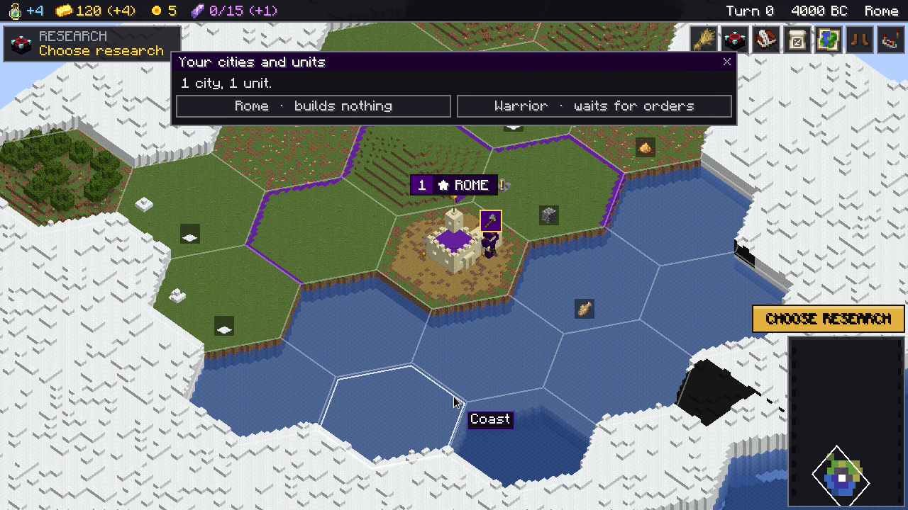

Two of those pages are laid out the way Civilization lays them out. **Speaking to another
people** shows whom you speak to on the left (their colours, a crowned head, and how they look
upon you), what they say beside it and what you can say back under that. **A deal** is a table:
what you give on the left, what you get on the right, a thing a line; under each side the
button that adds to it, and at the foot what they think of it (green when they would agree)
and the button that puts it to them.

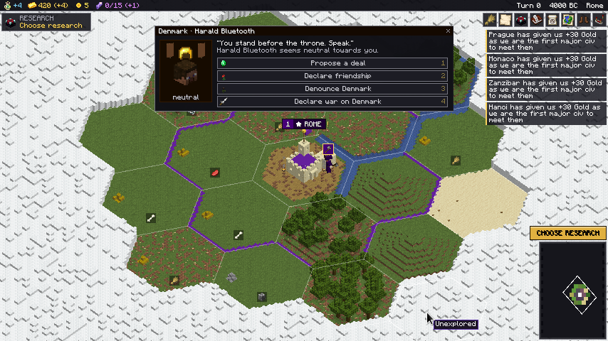

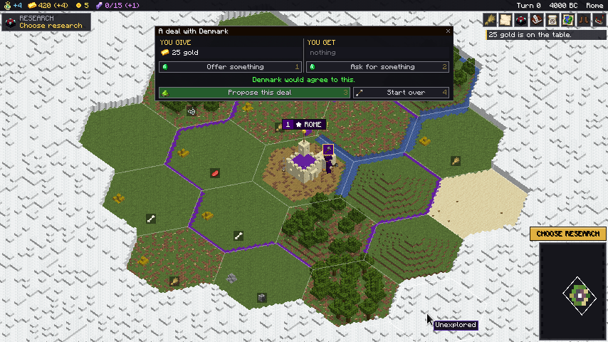

**The known world** (M) is everything your people have seen on one flat map: land by its
kind and its owner, cities by name, units as marks, and the frame of what the view shows. A
click goes there.

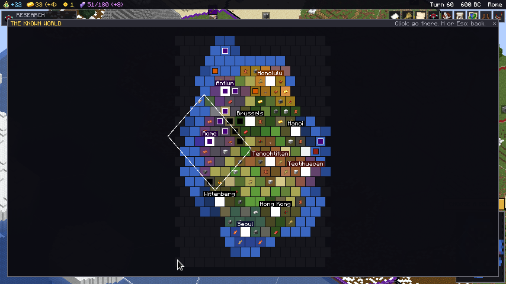

**War** looks as it does in Civilization: an enemy you can attack this turn has a red
outline, a right click on it attacks, and what happened is told on the right. **Before you
attack, rest the pointer on the enemy**: a card says who is the stronger, what each side is
expected to lose and have left, and what weighs on either side (the land, a river, a
promotion, a flank). A city of yours with an enemy in reach carries a small fire mark beside
its banner: click it, then one of the marked hexes, and the city fires (once a turn; the same
card says what the shot would do).

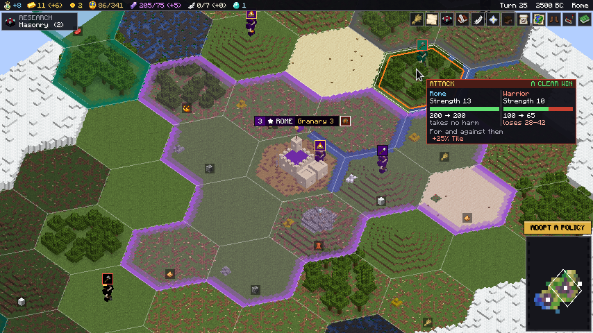

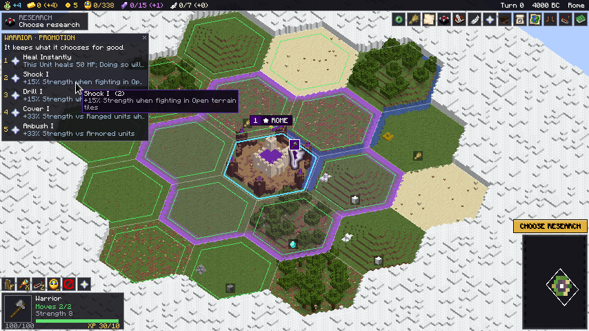

**Promotions.** A unit that has earned one blinks a gold mark over its flag and has a button
for it: the list says of each promotion what it gives. What a unit has is on its panel, a
small book for each (point at it to read it), beside its experience and what the next
promotion takes.

**Who is who.** The units are Minecraft's own creatures, picked by what they are and how
strong: zombies and skeletons for the first warriors and archers, drowned with tridents for
spearmen, wither skeletons, piglins and iron golems as the ages go on; creepers, blazes and
ghasts for catapults, cannons and artillery, ravagers for tanks, a warden for the Giant Death
Robot; riders on zombie and skeleton horses, ships as boats with a crew, villagers for
Workers and Great People, a wandering trader for a Settler, illagers for barbarians. Each
stands the larger the stronger it is and wears its owner's colour where it can wear anything.
Every city has a wall with a tower on each corner flying its owner's colour: a palisade at
first, stone later, higher once it has built walls or a castle.

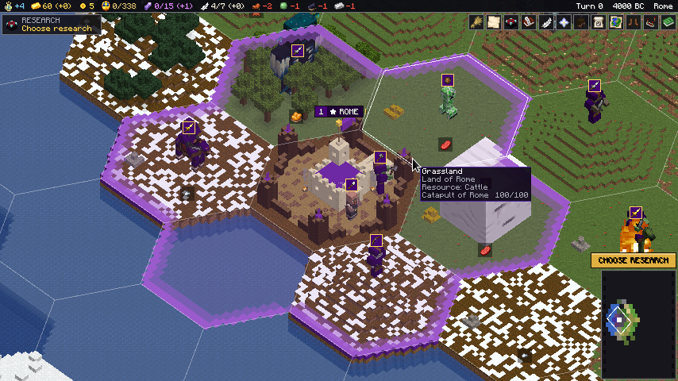

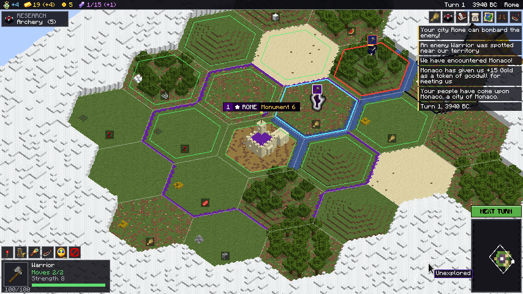

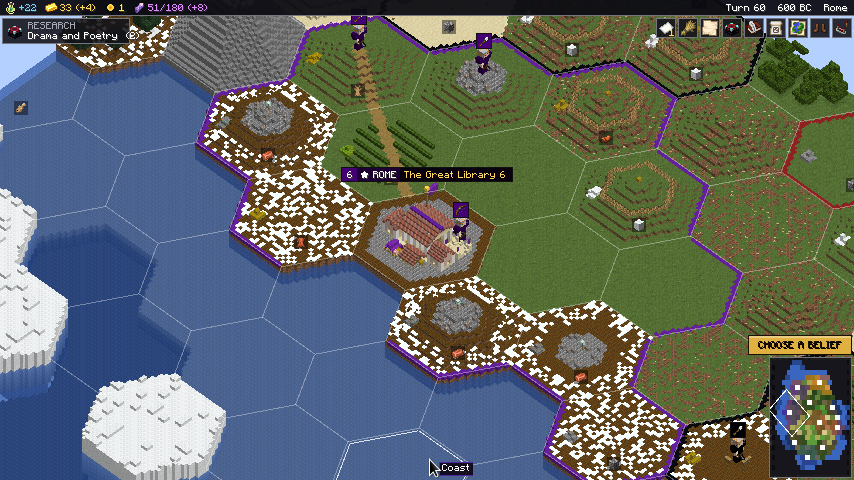

Should the view itself ever fail (it has been drawn on one kind of machine only), the game
does not: the view closes, a red line in chat says what went wrong, and you stand on the land
with the game going on as it is played on foot. F12 tries the view again.

Seen from above it is always noon, and a turn ends when you say so. When a new game begins,
or you look at a part of the map for the first time, the land is put down as you watch; a
line at the bottom says how much is still to come.

## Walking the land

**F12** sets you down on the land **where the pointer is**, in your own person; F12 again
lifts you back up. **A ruler is set down on their own land only**: point beyond your borders
and you land on the nearest hex that is yours (before your first city: beside one of your
units). Beyond your borders you walk. While you rule from above, your figure stands where you
last walked, in your own likeness, for everybody to see; a gold *YOU* marks it on the land
and on the small map, and with the pointer on a panel (or the boots, top right) F12 sets you
down there. Down there the game is Minecraft: walk through
your cities, fell trees, carry what the land yields to a city, eat, sleep. The corner of the
screen says whose land you stand on (*YOUR LAND*, *NOBODY'S LAND*, *LAND OF GREECE*, the name
of a city or a wonder) and what the thing in your hand is good for; for a few seconds after
you come down it also lists what walking is for. You carry the **Codex of** your
civilization, a book that opens the same pages as the buttons above, and units are as tall as
houses, because that is their size on the map. **Walking finds nothing**: the land is
explored by your units, turn by turn, and what they have not seen stays a wall of cloud to
you on foot as well.

**Your hands work your own land only.** Blocks can be broken and set down inside your own
borders, and nowhere else: not on a neighbour's land, not on land that is nobody's yet. No
city is taken apart by hand, your own no more than another's, and a wonder of the world stays
as it was built. (Somebody in Minecraft's creative mode builds where they like.)

**What walking is for.** What your forests, fields and hills yield grows back every turn. Carry
it to one of your cities (the governor: *Deliver what you carry*) and the city uses it:

| You carry | The city gets |
|---|---|
| Logs | 2 Production each |
| Raw iron | 3 Production each |
| Raw copper, coal | 2 Production each |
| Wheat, melon, berries, apples | 1 Food each |
| Pumpkin, fish | 2 Food each |
| Raw gold, gold ingots | 4 Gold each |
| Emeralds | 6 Gold each |

Hands help a city along; they do not do its work for it. A city takes from you no more
Production in a turn than it makes itself (but always 6), no more Food than 2 and one for
every citizen, and 10 Gold. What it cannot take stays in your pack. Ore needs the pickaxe
your people know how to make, so gold from the hills comes with Iron Working.

**An enemy unit you come near sends its soldiers at you.** Units at war with you, and
barbarians, are armies; within twenty blocks of one, up to three of its soldiers step out, one
after the other: life-size, the creature their unit is, as strong as their unit is, and with a
will of their own. They follow you, but never further than a hex or two from their unit, and
they fall back when you leave. Every soldier you beat costs the unit 20 health in the game
itself (a unit at its last falls, and what it carried is yours: a few gold). It is help, not a
war won by hand: a unit loses at most 60 health to you in a turn, all units together 150. Only
soldiers on land fight this way; workers, ships and aircraft do not.

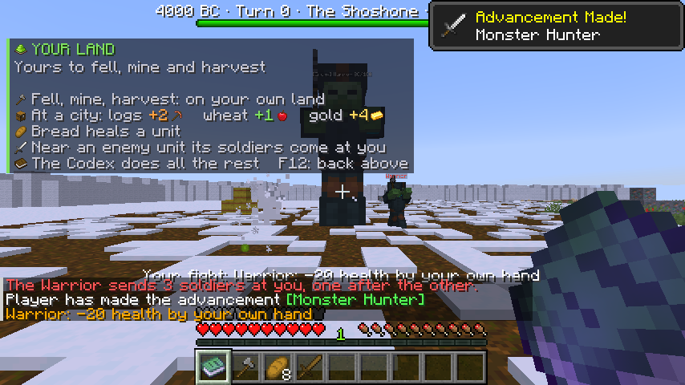

**If you fall, your people carry you home**: you stand before your capital again, your arms
and armour still yours. It costs a tenth of your treasury (100 gold at most) and whatever you
were carrying for your cities.

**Arms for yourself.** You come down the first time in leather in your colours, with a wooden
sword. The governor of any of your cities sells better, for gold from the treasury, as soon as
your people know how to make it:

| | Needs | Gold |
|---|---|---|
| A fishing rod (fish from your own shore is Food for a city) | Sailing | 15 |
| A bow and 32 arrows | Archery | 30 |
| Bronze arms: sword and armour of copper | Bronze Working | 40 |
| Iron arms: sword, armour and a shield | Iron Working | 100 |
| Steel arms: the best steel | Steel | 200 |
| Arms of the new age | Rifling | 350 |
| Training: one heart more, for good, five times | | 60, 120, 180, 240, 300 |

An explosion breaks blocks on the land of whoever set it off, and nowhere else; a fire burns
where it was lit and does not spread.

- **Right-click a unit of yours** to select it; its menu lists what it can do where it stands.
- **With a unit selected and the Codex in hand**, a green ring marks every hex it can reach, a
  red one every enemy it can attack. **Use the Codex on that land** and the unit goes there.
  **Sneak and use the Codex** to let the unit be.
- A unit that earned a promotion offers it in its menu. Bread heals: 10 health a loaf.
- **Aircraft** stay in their city and strike from there: select one, and everything it can hit
  is marked in red; send it there. A nuclear weapon is pointed the same way, at a place rather
  than at somebody, and falls at once.
- Riders sit on a horse, ships are boats on the water; a click on the horse or the boat is a
  click on the unit.

To play only this way, set `rts=false` in `config/livingworld.properties`: the game then
starts on foot, units are life-size, and a Minecraft day is a turn (see *Turns and time*).

## The Codex

| Page | What it is for |
|---|---|
| First page | Turn, year and era; treasury, science, happiness, culture; what you research; what must be decided before the turn can end |
| End the turn | The other civilizations move, then it is your turn again |
| Research | The technologies open to you, with the turns each takes and what it lets you craft |
| Policies | Adopt a social policy when your culture has earned one |
| Your cities and units | Every city with what it builds, every unit with what it is doing (those waiting for orders first). Choosing one opens its menu; a unit is selected and you can go to it |
| Other civilizations | Everyone you have met: propose a deal, declare friendship, denounce, declare war, offer peace; for city-states gifts of gold and a pledge to protect them |
| Choose your beliefs | Shown when your people are ready to say what they believe |
| Proposals | What other civilizations offer or demand. Shown when there is something; accept or decline each |
| Look from above | The map view |
| Work the land here | Build an improvement on the hex you stand in, with materials you gathered |
| Travel | To your capital or any city you know |
| Settings | The rules below, and *Start a new game* |

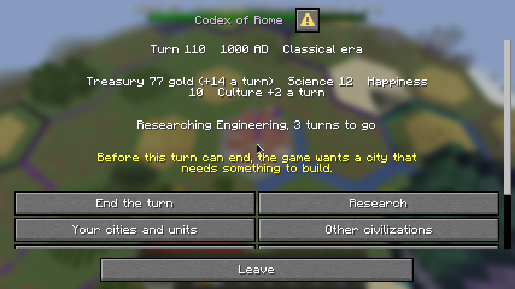

## Cities

A Settler founds a city where it stands. From then on the city is there in blocks: a hall in
the middle and up to eight lots around it, built in the manner of your era and your people.

| Era | The hall | Houses |
|---|---|---|
| Ancient | A long timber hall under thatch; in dry and Mediterranean lands a walled house of sandstone | Huts of mud brick and thatch, or flat-roofed sandstone |
| Classical | Columns all round under a low tiled roof | Plastered walls, red tiles; timber and shingles further north |
| Medieval | A stone keep with battlements and corner turrets | Half-timbered: a stone foot, white plaster between dark beams |
| Renaissance | A town hall with two rows of windows, a steep roof and a clock tower | Brick or plaster, slate or tile, chimneys |
| Industrial | The same in darker stone, with a smoking stack | Brick and slate |
| Modern | A tower of glass and concrete | Blocks of flats |

What the city has built stands on its lots, each with a shape of its own: monument, granary
(a silo later on), barracks with the soldiers' tent, library, shrine or temple, market stalls,
workshop with its forge, well, arena, stable, lighthouse. The lots left over are houses, and a
city that outgrows its lots builds them taller. Walls, once built, stand around the whole.

**A wonder of the world stands on a hex of its own** beside its city, on the city's own land,
many times the size of a house and under its builder's colours: the Pyramids seventeen blocks
across with a cap of gold, Stonehenge as a ring of standing stones, the Great Library behind
its colonnade, the Great Lighthouse, a colossus of copper for the wonders that are statues, a
great tower, a temple of terraces hung with green, a domed hall with four slender towers; the
others take one of these by what their name suggests. Its name stands over it on the map, and
the hex goes on being worked as before. A city with more wonders than it has land around it
keeps the rest among its houses.

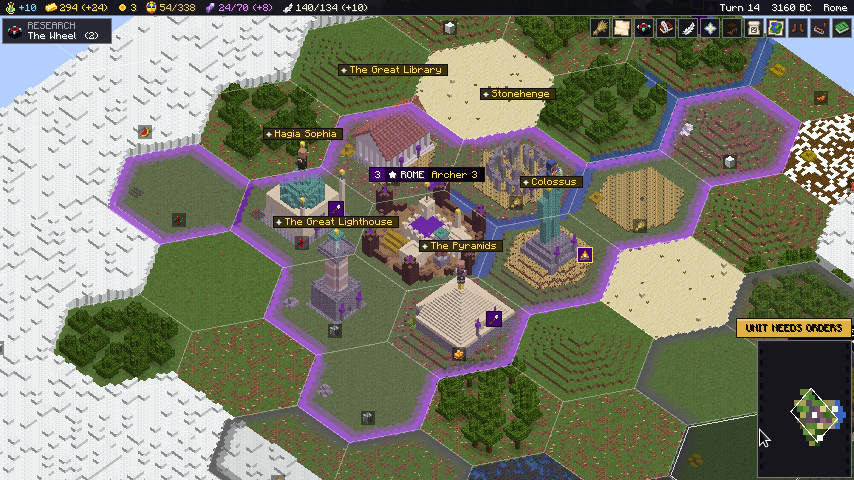

Your colour is on every hall: along the ridge or on the roof, on the flag, on banners, market
awnings and tents. A capital carries gold on its flagpole.

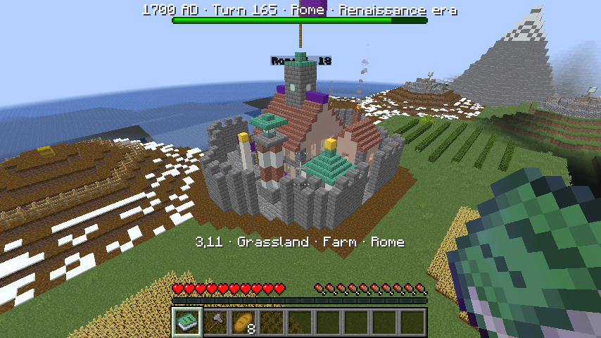

**Inside the hall of each of your cities:**

- **The governor.** Right-click: what the city builds (the game's own list, with turns), *buy
  with gold* (the same things, with their price, there at once), *deliver what you carry* (see
  *Walking the land*),
  and *what becomes of* the city: a puppet can be annexed, a city somebody else founded given
  back to them, any city but a capital razed, and spared again while it still stands.
- **The bell.** Ring it to end your turn.
- **The lectern.** Read it to choose research.

Cities defend themselves: one that can shoot at an enemy in range does so when your turn ends.

**When a city falls to you** a page opens at once: it is yours, held as a puppet, and you say
what becomes of it. Leave it a puppet (it pays, runs itself, and weighs little on your people's
mood), annex it, give it back to whoever founded it (they will not forget), or raze it.

## The others

Of another civilization you can also **ask** that it found no cities near you, keep its
religion out of your cities, or stop spying on you. The computer answers with its turn (the
news says how); a person finds it among their proposals. Whoever gives their word and breaks
it pays for that with everybody.

A city-state that asks something of you says so on its page; *What they ask, in full* says
exactly what, how long the request stands, what it is worth in influence and where you stand
with them.

You meet other civilizations and city-states when your units find theirs. They are then listed
under *Other civilizations* in the Codex, and the governor of any of their cities receives you.
Whether another civilization agrees to something is decided by the game's own AI, the same that
decides it between two computer players: peace is refused while the war is young or going well
for them, friendship while they think little of you. What they put to you (a trade, a demand
not to settle near them) waits under *Proposals* in the Codex until you answer; you are told
when something arrives.

**Deals.** *Propose a deal* opens a table between you and them. *Offer something* and *Ask for
something* list what each side has to give right now: gold in round sums, gold a turn,
luxuries and strategic resources, open borders, an embassy, a research agreement, a defensive
pact, peace when you are at war, cities, an introduction to somebody you have not met, and
war or peace with a third civilization. Put things on the table piece by piece; the page says at
every step whether they would agree to the deal as it stands. *Propose this deal* makes it, if
they do.

## What your people believe

**Faith stands at the top of the screen**, with what a turn brings and what the next step
takes. It comes from shrines and temples, from wonders, from some land and from city-states of
the religious kind. When your people have gathered enough, the game asks for their pantheon: a
page lists the gods still free, each with what it gives. When a Great Prophet founds a religion
in one of your cities (*Found a religion* among his buttons), you choose its beliefs one after
another, and again when a Prophet deepens it. The turn waits for these choices.

**Faith and religion** (R, the feather at the top right, or a click on the faith at the top)
is the page for all of it: what your people believe and what each belief gives, how much faith
the next pantheon or prophet takes, which religion holds each of your cities and how many of
its citizens follow it, and the religions of the others you have met.

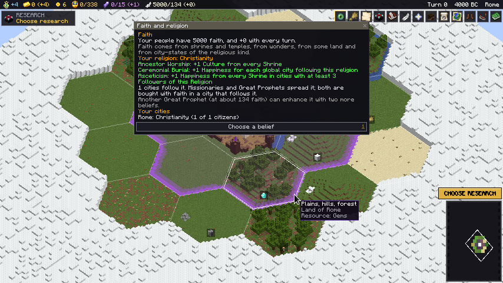

**Faith buys** what work and gold cannot: Missionaries, Inquisitors and later Great Prophets
in a city whose people follow a founded religion, and the buildings some beliefs add. *Faith*
under a city's list shows what is on offer there and for how much.

## Spies

A game is set up with spies unless the table says otherwise. The first comes with the
Renaissance, another with every age after it; an eye at the top right appears with them (it
blinks while one waits for orders), and the settings have the same page. It lists every spy:
who, of what rank, where and at what. *Send ...* lists the cities one could go to: a city of
another civilization (it steals what they know and you do not), a city-state (it rigs the
elections for your influence, and can stage a coup against its ally), or a city of your own (it
guards against theirs). Moving and settling in take a few turns; what a spy brought about is
told in the news.

## Keeping a game

The game is saved by itself after every turn. *Keep a copy of this game* (settings) puts the
game as it stands this moment beside it, named by its turn, your civilization and the time;
*Go back to a kept game* lists the copies, and a click goes back to one (whoever keeps the
world decides that). The game you were in is set aside, not lost, and everybody has their own
civilization again.

## Winning

**The ways to win** (V, the star at the top right, or a click on the turn and year) says for
each way that counts in this game what it takes, what of it you have done and how far the
others are; the score of everybody you have met; and how you compare in population, land,
production, gold, armies, happiness, technologies and culture. The game is called on score
after the last turn of its length (Quick 330 or so, Standard 500, Epic 750, Marathon 1500).

Unexplored land is a wall of cloud; your units reveal it as they go.

## Research and crafting

Minecraft crafting follows your technologies:

| Technology | Lets you craft |
|---|---|
| Archery | Bows and arrows |
| Sailing | Boats |
| Writing | Books, bookshelves, the lectern |
| Bronze Working | Copper tools and armour |
| Iron Working | Iron tools and armour, buckets, shears, the shield |
| Optics | The spyglass |
| Philosophy | The enchanting table |
| Metal Casting | The anvil |
| Compass | Compasses and maps |
| Machinery | The crossbow |
| Steel | Diamond tools and armour |
| Gunpowder | TNT and fireworks |
| Chemistry | The brewing stand |
| Industrialization | The blast furnace |
| Railroad | Rails and minecarts |
| Electricity | Pistons and redstone machines |

## Working the land yourself

Workers improve the land: tell one what to build where it stands, or let it *work by itself*.
You can also do it with your own hands, at once, with what you gather in Minecraft:

- **Clearing forest.** Fell 24 logs in one forest or jungle hex within one turn and the forest
  is cleared for good, inside your borders and once your people know how.
- **Improvements.** Sneak and use the Codex on the ground with no unit selected (or *Work the
  land here*) for what could be built on that hex. Three works a turn.

| Build | Costs |
|---|---|
| Farm, plantation | 16 wheat seeds |
| Mine, quarry | 32 cobblestone |
| Road | 16 cobblestone |
| Pasture | 16 wooden fences |
| Camp | 16 logs |
| Fort | 64 cobblestone |
| Railroad | 16 iron ingots |
| Anything else | 32 planks |

**Buying land.** Sneak and use the Codex on a hex that belongs to nobody and lies next to
land one of your cities holds: the city can buy it from the treasury, at the game's price, and
it is the city's at once.

What the land yields (wood, crops, ore outcrops of resources) grows back every turn. What you
build or dig yourself stays when the land around it is repainted.

## Turns and time

From above, a turn ends when you press the turn button. On foot, one Minecraft day is one
turn: the sun rises when your turn starts and takes ten minutes to set; at sunset the turn ends
by itself. The bell, or *End the turn* in the Codex, ends it sooner. The turn does not end while a decision is open: a social policy to adopt, a choice of
research, a city with nothing to build, a belief to choose, a vote to cast. You are told
which, and its page opens. Units without orders simply wait.

A click is a click: right-clicking a unit selects it and nothing else, and the bell rings once
however long you hold the button.

## What the game tells you

Founded, captured and lost cities, finished wonders, war and peace, a new technology or era,
what your units met and what happened to them, proposals waiting, and the end of the game
(somebody's victory, or your fall) come as news. From above that is **a column of small
pictures down the right side**, one for each piece, by what kind it is (a sword for war, a
bell for a city, a pickaxe for something built, a bottle for a discovery). A new one says its
words beside it for a few seconds and then keeps quiet; point at it to read it again.
**Click** one and the view goes to the place it is about and opens what deals with it (the
city, the tree of technologies, the policies, the proposals); **right-click** puts it away,
and the small *x* under the column puts all away. A word on what you just did yourself
(*Rome has new orders*) passes along the bottom of the screen and is gone. **N** lists all of
it, the newest first. On foot the news comes as lines in chat. After a victory you can play
on.

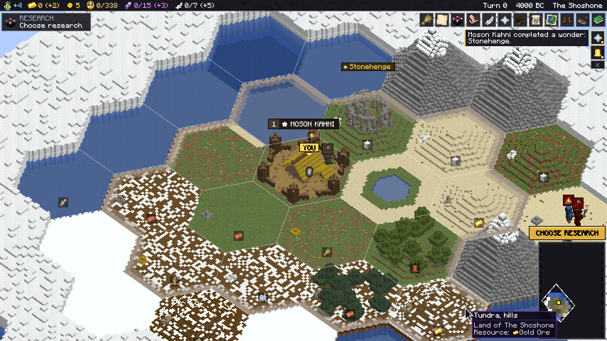

**What you hear.** A unit that walks, one that is hurt and one that falls sound like the
creature they are; a city founded rings a bell, something built is a hammer on an anvil, a
discovery, a wonder and the horn of war have their own. They are few: of everything that
happened between two turns you hear the nearest, louder the nearer it is to what you look at;
on foot only what is close by.

## Settings

In the Codex, remembered in `config/livingworld.properties`:

| Setting | Default | Meaning |
|---|---|---|
| A day is a turn | yes | Your turn ends by itself at sunset |
| Crafting follows your technologies | yes | No iron tools before Iron Working |
| Walking explores the land | yes | With a running Civilization V only: stepping into a hex reveals the land around it. In the game that runs inside Minecraft walking finds nothing |
| Cities choose their own work | no | A city with nothing to build picks something itself, so no turn waits for it |

*A new game...* (on the page behind **L**, or *Start a new game* in the settings) sets up the
next one at the same table the first game was set up at. The game you were playing is set
aside in the world's folder as `livingworld-civ.previous.json`.

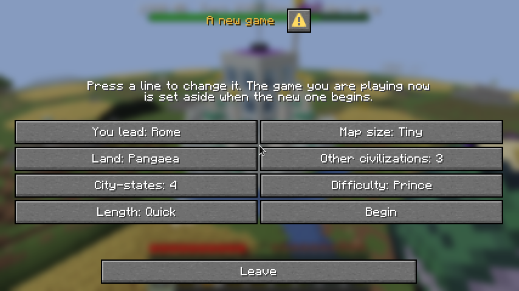

## What is decided for you

Little: which citizens work which land, the name of your religion, and what happens in the
first moment after a city falls (see above; you decide from there). The full list, and what
is missing altogether, is in [KNOWN_LIMITATIONS.md](KNOWN_LIMITATIONS.md).
