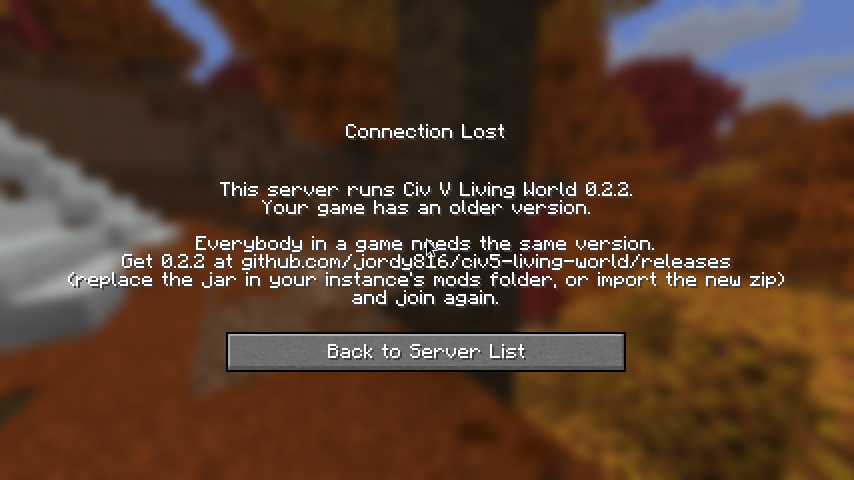

# Installing

Three ways in, from the easiest: the ready-made instance for players, the server pack for
whoever hosts, and the bare mod for an installation of your own. All three are files of one
[release](../../../releases/latest). **Everybody in a game needs the same version of the
mod**: the host and every guest.

| File of the release | For |
|---|---|
| `CivLivingWorld-<version>-prism.zip` | Players: a whole Minecraft instance for Prism Launcher |
| `CivLivingWorld-<version>-server.zip` | Hosts: a server with the mod, ready to start |
| `civ5-living-world-<version>.jar` | The mod alone, for a Fabric installation you made yourself |

## To play (Prism Launcher)

You need Minecraft: Java Edition, bought on your own account.

1. Install [Prism Launcher](https://prismlauncher.org) and sign in with your Minecraft
   account (top right, *Accounts*).
2. Download `CivLivingWorld-<version>-prism.zip`. Do not unpack it.
3. In Prism Launcher: **Add Instance > Import**, choose the zip, **OK**. Prism downloads
   Minecraft 26.3, Fabric and a fitting Java by itself; that takes a few minutes the first
   time.
4. Select the new instance and press **Launch**.

Alone: the world opens by itself and you are at the table where a game is set up. Choose a
civilization on the left, the map and the rules on the right, and **Begin**. The game is kept
in that world: next time it goes on where you left it.

With others: leave the world that opened by itself (**Esc** twice, **Save and Quit to
Title**), then **Multiplayer > Add Server**, the address your host gave you, **Join Server**.
No game running yet? You sit at the same table as your host and pick a civilization. A game
already under way? You get a list: take over a civilization the computer plays, rule along
with somebody, or just look on.

The instance gives Minecraft 4 GB of memory. On a machine with 8 GB in all, lower it to 3 GB
(*Edit > Settings > Java*).

### Updating

Download the newer zip and import it as a new instance, or replace the one file
`civ5-living-world-<old>.jar` in the instance's `mods` folder (*Edit > Mods*, or *Folder*) by
the newer jar. Your worlds stay where they are.

## To host a game

### The quick way: open to LAN

For people in the same house: start a game alone, **Esc > Open to LAN > Start LAN World**.
The others see it under *Multiplayer*. Whoever opened the world is the host.

### A server

For friends elsewhere, or a game that goes on when you are not there. Any machine with
**Java 25** and 4 GB of memory to spare will do, Linux or Windows.

1. Unpack `CivLivingWorld-<version>-server.zip` in a folder of its own.
2. Read `eula.txt`: by changing `eula=false` to `eula=true` you accept
   [Minecraft's EULA](https://aka.ms/MinecraftEULA).
3. Open `server.properties` and look at the first lines. As it comes the server listens on
   port 25565, checks every account with Mojang (`online-mode=true`) and lets in only who is
   on the list (`white-list=true`).
4. Start it: `./start.sh` (Linux, macOS) or `start.bat` (Windows). The first start downloads
   Fabric's server launcher and Minecraft's own server (about 60 MB) and makes the world.
5. In the server's own window, let yourself and your friends in, and make yourself the host:

   ```
   whitelist add YourName
   whitelist add FriendsName
   op YourName
   ```

6. Give your friends the address: your public address and the port, as in
   `203.0.113.7:25565`. At home that needs a port forward on your router: TCP 25565 to the
   machine the server runs on.

The first operator who joins finds the table and sets the game up; the others pick a
civilization there. On a server without operators the first to join keeps the world.

What matters in `server.properties`:

| Line | Why |
|---|---|
| `level-type=livingworld\:board` | The world is the board of the game: an empty world the mod lays out in hexes. Must be there before the world is first made |
| `online-mode=true`, `white-list=true`, `enforce-whitelist=true` | Only people you let in. Somebody who joins takes a seat in your game, so do not run it open |
| `view-distance=20` | The view from above shows a wide stretch of land. Lower it (12) on a small machine |
| `allow-flight=true` | Rulers fly over their land |
| `max-tick-time=-1` | A long turn of the other civilizations is not a hung server |

The game is kept in the world folder (`world/livingworld-civ.json`, and copies you ask for in
`world/livingworld-kept/`). Back that folder up and you have backed up the game. To begin
anew, the host presses *Settings > A new game* in the game itself; nothing has to be deleted.

### Updating a server

Stop it, replace `mods/civ5-living-world-<old>.jar` by the newer jar, start it. Everybody who
plays on it needs the same new version.

## By hand (your own Fabric installation)

For Minecraft **26.3** with [Fabric Loader](https://fabricmc.net/use/) 0.19.5 or newer and
Java 25: put `civ5-living-world-<version>.jar` and
[Fabric API](https://modrinth.com/mod/fabric-api) for 26.3 in the `mods` folder. When the
game starts, the mod makes and opens its own world (*Living World*) by itself; set
`autoOpen=false` in `config/livingworld.properties` if you would rather start at Minecraft's
own title screen. The mod has not been tried together with other mods; shaders and
mods that change how the world is drawn (Sodium, Iris) are the likeliest to disagree with
the view from above.

## When something is wrong

- **"Outdated client" or "Outdated server"**: host and guest have different Minecraft
  versions. The mod is for 26.3 only.
- **"This server runs Civ V Living World 0.2.2. Your game has ..."** on the screen you are
  sent back to: host and guest have different versions of the mod, and the server lets in only
  its own. Take the version it names from the releases, replace the jar in the instance's
  `mods` folder (or import the new zip), and join again. (A server from before 0.2.2 cannot
  say so: with an older game on it the view from above just stays empty, and
  `logs/latest.log` has *could not read the view*.)
- **A host who updates the server**: tell the guests first, and update your own game before
  the server. Whoever joins with another version is told so on that screen.

  
- **You joined and see an ordinary Minecraft world**: the server's world was made before
  `level-type=livingworld\:board` was set. Stop the server, move the `world` folder away,
  start it again.
- **You are not let in ("You are not white-listed")**: the host adds you with
  `whitelist add YourName`.
- **The view from above closed with a red line in the chat**: a fault in the view costs the
  view, not the game. Press F12 to go back up; the game went on. Please report it with the
  file `logs/latest.log` of the instance.
- **Slow**: lower *Render Distance* in Minecraft's video settings; the view from above raises
  it to 20 while you look down and puts your own value back when you walk.

Reports and questions: the [issues](../../../issues) of this repository, with what you did,
what you saw, and `logs/latest.log`.
