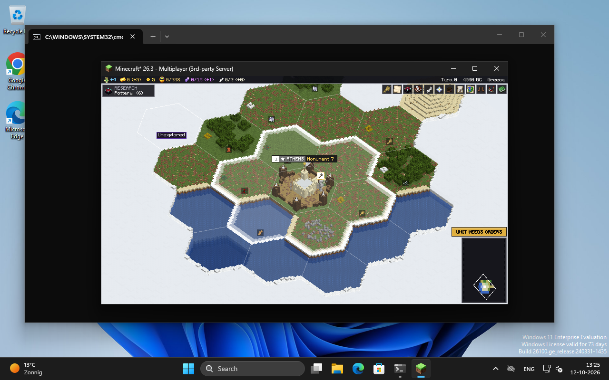
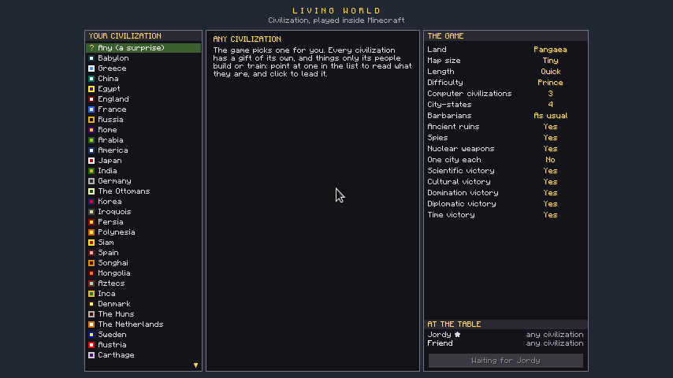
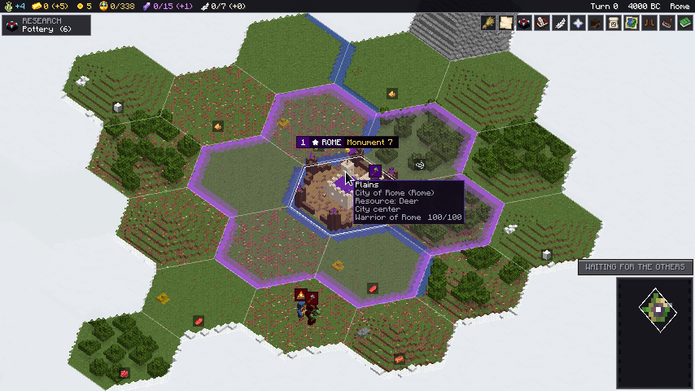
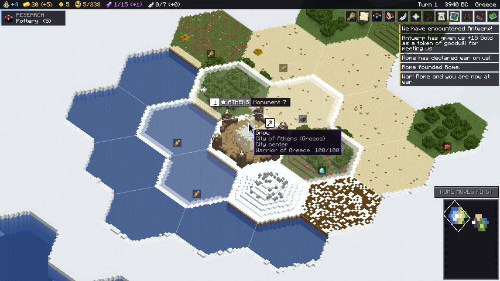

# Playing with others

One game of Civilization, several people, each with a civilization of their own. Everybody
needs the same instance (this mod and Fabric API, Minecraft 26.3); the game itself runs on
whoever hosts.

What of this has been tried, and how, is in [TESTING.md](TESTING.md) and
[KNOWN_LIMITATIONS.md](KNOWN_LIMITATIONS.md). In short: the rules below hold in the engine's
tests and in the server's self-test (on Linux and Windows). On 2026-10-12 they were played
through twice with real Minecraft clients joined to a dedicated server on Windows:

- **Two clients on one machine**, both steered by a script: the table, a civilization each,
  a turn at once, the turn waiting for the second, a war between the two fought in turns over
  a whole round, a kept game gone back to with both in their places.
- **Two clients on two machines, two players**: one on the build machine (Linux), one on a
  Windows PC, the second played by another agent that saw only that PC's screen and worked
  its mouse. The Windows player kept the world: chose Greece and began the game, founded
  Athens, chose research and production; the first had ended the turn and read *Waiting for
  the others*; the Windows player clicked *Next turn*, and turn 1 began on both screens.

Two people of flesh and blood at two machines have not played it yet; what they need is
below.

| At the table | One has ended the turn | At war |
|---|---|---|
|  |  |  |

## What the others need

`CivLivingWorld-<version>-prism.zip` of a release (made by `scripts/dev/share-instance.sh`)
is the whole instance: Minecraft 26.3 with Fabric, Fabric API and the mod.
[INSTALL.md](INSTALL.md) has every step, [MEESPELEN.md](MEESPELEN.md) the same in Dutch. Whoever plays along installs [Prism Launcher](https://prismlauncher.org),
signs in with their own Minecraft account, and imports the zip (*Add Instance > Import*).
`README-FOR-A-FRIEND.txt` beside it (and inside it) says the same in a few lines. Everybody
must have the same build of the mod as the host: send the zip again after an update.

## Hosting

**From your own game (the simple way).** Open your world as always, press Esc, *Open to LAN*.
Friends on the same network see it under *Multiplayer*; friends elsewhere need the port the
game names forwarded to your machine, or a tunnel. The game is yours: you keep the world,
you set up new games.

**A server of its own.** A Fabric server for Minecraft 26.3 with this mod and Fabric API in
its `mods` folder; `CivLivingWorld-<version>-server.zip` of a release is one, ready to
start ([INSTALL.md](INSTALL.md)). `config/livingworld.properties` there is the same file as in a player's
instance. Whoever is an operator (`ops.json`) keeps the world; with no operator online, the
first player who came in does.

## Beginning a game together

With no game in the world, everybody who comes in sits at the same table: each picks a
civilization (two people cannot pick the same), whoever keeps the world sets the map and the
rules and presses *Begin the game*. Everybody at the table gets a civilization of their own;
the computer plays the others.

## Coming into a game that runs

Whoever had a civilization has it again. A newcomer gets a page that lists every
civilization and who rules it:

- **Take over** a civilization the computer plays: it is yours from now on, as it stands.
- **Rule along** with somebody: one civilization, one turn, two people giving its orders.
- **Just look on**: no civilization; the turn button says *Looking on*.

The same page is behind the head at the top right, or **L**, at any time: to take another
civilization (yours goes back to the computer when nobody else rules it) or to look on.

## Turns

- **Everybody moves at once.** Your turn button ends your turn; it then says *Waiting for the
  others* and your units take no more orders. When everybody who is there has ended theirs,
  the computer's civilizations move and the next turn begins for all.
- **War between two people is fought in turns.** From the moment two of you are at war, the
  one whose civilization comes first in the game's list moves first; the other's button says
  *Rome moves first* until the first has ended their turn, and then it is theirs. Everybody
  who is not in that war goes on moving at once. Peace puts it back.
- **Somebody away holds nobody up.** A civilization whose people are all offline is played by
  the computer for as long as they are away, the way it plays its own. The game does not move
  on while nobody is there at all.
- **A decision the turn waits for** (research, production, a policy, a belief) is each
  player's own; it only stops their own *Next turn*.

## Dealing with each other

War is declared as on anybody. **Peace, a declaration of friendship and a deal** between two
people are put to the other as a proposal: a paper appears at the top right of their screen,
and it is theirs to accept or decline. Nothing is decided for a person by the computer.

## What each sees

Each sees the land their own people have explored, the units their own people see, and their
own news. The world itself is built from what anybody has explored, so on your screen the
land you have not seen lies under cloud, and what stands on land you do not see right now is
not shown.

## Where it is kept

`livingworld-civ.json` in the world's folder is the game; `livingworld-seats.txt` beside it
says which player rules which civilization (a player's id and the number of the civilization
in the game's list). Deleting the second makes everybody choose again; the first player in
gets the first civilization of a person.
