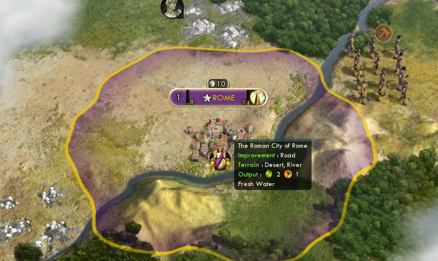
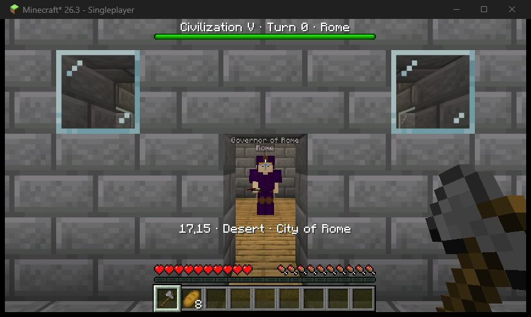

# Rendering

The brief asked for three things, in order of ambition. This is what exists, what was found,
and where the line was drawn.

## A1: the player on Civ's own map. Built.

A marker with the face of the player's own leader sits on Civ's real map at the player's exact
position and moves with the player as they walk in Minecraft; the player's name shows as its
tooltip. Civ's camera follows when `follow` is on (hex by hex: Civ has no call for a free camera
position). Seen working on the real game, see the pictures here and in the README.

Added after those pictures and so far only tested against the fake Civ API: the player's name
floating up from the marker each time they step into another hex.

It is drawn by Civ's own interface, as a world-anchored control, so it stays in place under
panning and zooming and needs no graphics hook.

Limits: it is an icon, not a Minecraft model; it draws on top of the map like a unit flag does;
on a map that wraps east-west it appears on one copy of the world only.

## B: Civ's map as a Minecraft world. Built, as the place you walk.

Not a replacement for A1 but its other half: something has to be under the player's feet. The
board is computed from Civ's live state for every column of blocks (`BoardModel`) and repainted
when Civ changes. Hexes are true hexagons, 32 blocks across by default.

| In Civ | In Minecraft |
|---|---|
| Grassland, plains, desert, tundra, snow | Grass; grass with coarse dirt and dry grass; sand; podzol with snow patches; snow |
| Hills | A walkable dome, up to 6 blocks |
| Mountain | A stone cone with a snow cap, too steep to walk |
| Coast, ocean, ice | Shallow and deep water; packed ice |
| River | A two-block channel along the hex edge Civ says it is on |
| Forest, jungle, marsh, oasis, flood plains | Oak or spruce trees; tall jungle trees; mud and pools; a pond; lush grass |
| Natural wonder | A quartz spire |
| Road, railroad | Path or cobble from the hex centre towards connected neighbours |
| Farm, mine, pasture, camp, plantation, quarry, other | Wheat field; ore patch with a lamp post; fenced ring; campfire; bush rows; pit; a small hut |
| Territory | A line of concrete in the owner's colour where the neighbour has another owner |
| City | A keep with a flag in the owner's colour and eight lots around it, built in the civilization's era (six steps from mud brick to concrete) and building style; on the lots the buildings and wonders Civ built there, then one house per citizen; a wall when the city has Walls or a Castle. In the halls of the player's own cities: a bell and a lectern behind the governor |
| Resource | An outcrop of ore, stone, or a patch of its crop beside the centre of its hex |
| Unexplored | A wall of white cloud, three blocks higher than the land |

Not shown yet: city interiors, and the buildings of other civilizations' cities. The era and
resource rows above were built after the last session on the real games and have only been seen
on the headless server.

## A2 and compositing: a first-person view inside Civ's renderer. Not built.

Looked into, not attempted, for reasons that are properties of Civ V and not of effort:

- **No camera to take over.** The engine interface the game core gets has `lookAt`,
  `centerCamera` and `releaseLockedCamera` and nothing else; Lua has less. The four reference
  projects all read and write their host's camera at fixed memory addresses found by reverse
  engineering that engine.
- **The world is built to be seen from above.** Tiny unit models, no sky, culling and level of
  detail tuned for a strategic camera, a map that wraps. A low camera would show the seams even
  if it could be moved.
- **32-bit, D3D11.** The Windows reference code is 64-bit D3D12 with shared GPU textures. A
  Civ V version would be a new 32-bit injected module with its own frame transport.

A reasoned estimate from the code review: drawing Minecraft entities into Civ's 3D scene with
correct depth is four to eight weeks of work with roughly even odds, and with a top-down camera
the visible gain over the marker is small. A first-person camera in Civ's renderer is months
with low odds.

If someone wants to go further, the cheapest step that would add something real is to replace
the marker's icon with a live picture of the Minecraft character: one small D3D11 hook that
overwrites the marker's texture, no matrices or depth needed. That was not started.

## Input

The games are two ordinary windows. Whichever has focus gets the keyboard and mouse, so there
is nothing to switch and no F8 key. Put them side by side or on two screens.
